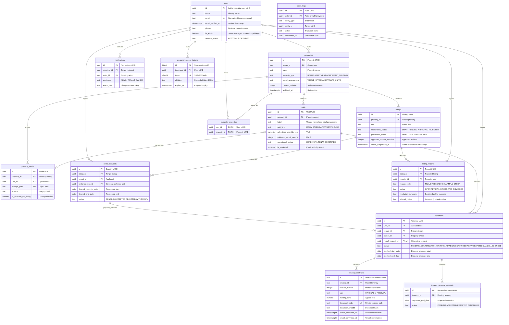

# rentOS

A long-term rental management platform for Da Nang, Vietnam — connecting verified property owners and prospective tenants with structured discovery, private favourites, idempotent rental enquiries, immutable contract proposals/renewals, moderation/report workflows, and real-time operational monitoring.

---

## 1. Tech Stack & Verified Runtime Versions

| Layer | Technology | Target / CI Version |
| :--- | :--- | :--- |
| **Backend API** | Laravel 13 + Fortify + Sanctum + Scramble OpenAPI | **PHP 8.4** (with `pdo_pgsql`, `pcov`) |
| **Database** | PostgreSQL (UUID PKs, Check Constraints, Partial Indexes) | **PostgreSQL 17** |
| **Frontend Web** | Next.js (App Router) + React 19 + TypeScript + Tailwind CSS 4 | **Node.js 22** |
| **Storage & Media** | Supabase Storage (Private Admin/Contract buckets & Public Media) | Local Supabase or Hosted Project |
| **Testing & QA** | PHPUnit 12, Laravel Pint, PHPStan (Larastan Level 5), Vitest + V8, ESLint | Separate Backend & Frontend >70% Coverage |

---

## 2. Project Structure

- `backend/` — Laravel 13 REST API, Domain Actions, Policies, FormRequests, Jobs, Monitoring, and PostgreSQL integration tests
- `frontend/` — Next.js App Router web application (Public Discovery, Tenant Portal, Owner Portal, Admin Portal)
- `docs/` — Product requirements (`docs/01-product/`), module specs (`docs/03-modules/`), workflows (`docs/04-workflows/`), architecture & ERD (`docs/07-architecture/`), acceptance & rubric (`docs/06-acceptance/`, `docs/08-project/`)
- `design/` — Brand guidelines, UI/UX standards, and screen specifications
- `.github/` — CI workflows (`.github/workflows/ci.yml`) and PR templates

---

## 3. Clean-Machine Setup Instructions

### 3.1 Prerequisites
- **PHP 8.4+** with `pdo_pgsql`, `pcov`, `mbstring`, `openssl`, `tokenizer`, `xml`
- **Composer 2.x**
- **Node.js 22.x** & **npm**
- **PostgreSQL 17** (or Supabase CLI local stack on port `54322`)

### 3.2 Backend Setup (`backend/`)
```bash
cd backend
cp .env.example .env
composer install --no-interaction --prefer-dist
npm ci && npm run build
php artisan key:generate --no-interaction

# Run migrations and seed deterministic baseline data
php artisan migrate
php artisan db:seed --class='Database\Seeders\BaselineSeeder' --no-interaction

# Optional: seed bulk performance dataset or workflow-specific fixtures
# php artisan db:seed --class='Database\Seeders\BulkDataSeeder' --no-interaction

# Start the API server (port 8000)
php artisan serve
```

### 3.3 Frontend Setup (`frontend/`)
```bash
cd frontend
cp .env.example .env.local
npm install
npm run dev
```
Open [http://localhost:3000](http://localhost:3000).

> [!NOTE]
> Make sure `npm install` (or `npm ci`) is run in `frontend/` so `@vitest/coverage-v8` is available for `npm run test:coverage`.

---

## 4. Environment Variables (Names Only — No Secrets)

### 4.1 Backend (`backend/.env.example`)
| Variable | Purpose |
| :--- | :--- |
| `APP_NAME`, `APP_ENV`, `APP_KEY`, `APP_DEBUG`, `APP_URL` | Core Laravel app identity and origin (`http://localhost:8000`) |
| `DB_CONNECTION`, `DB_HOST`, `DB_PORT`, `DB_DATABASE`, `DB_USERNAME`, `DB_PASSWORD`, `DB_SSLMODE`, `DB_SEARCH_PATH`, `DB_SCHEMA` | PostgreSQL 17 connection (`pgsql`, port `54322` locally) |
| `SESSION_DRIVER`, `SESSION_LIFETIME`, `SESSION_DOMAIN`, `CACHE_STORE`, `QUEUE_CONNECTION` | Database-backed sessions, cache, and async jobs (`database`) |
| `NOTIFICATIONS_MAILER`, `MAIL_MAILER`, `MAIL_FROM_ADDRESS`, `MAIL_FROM_NAME`, `RESEND_API_KEY` | Domain notifications (`log` locally, `resend` in production) |
| `SUPABASE_URL`, `SUPABASE_SERVICE_ROLE_KEY`, `SUPABASE_STORAGE_BUCKET`, `SUPABASE_STORAGE_MAX_FILE_SIZE_KILOBYTES`, `SUPABASE_STORAGE_MAX_MEDIA_PER_PROPERTY` | Backend-only Supabase Storage integration (never expose `SERVICE_ROLE_KEY` to frontend) |
| `TELESCOPE_ENABLED`, `TELESCOPE_MAIL_WATCHER`, `TELESCOPE_NOTIFICATION_WATCHER` | Local diagnostics via Laravel Telescope (`false` in CI/production) |
| `MONITORING_SLOW_QUERIES`, `SLOW_QUERY_MS`, `SLOW_QUERY_CRITICAL_MS`, `SLOW_QUERY_DISCORD_COUNT`, `SLOW_QUERY_DISCORD_WINDOW_SECONDS`, `SLOW_REQUEST_DB_MS`, `DB_TIME_DISCORD_COUNT`, `DB_TIME_DISCORD_WINDOW_SECONDS`, `OPS_ALERT_EMAIL`, `OPS_ALERT_DEDUPE_SECONDS`, `DISCORD_ALERT_WEBHOOK` | Slow-query & cumulative DB-time monitoring thresholds and alert channels |
| `OWNER_REQUIRE_VERIFIED_EMAIL` | Enforce verified email for owner product mutations (`true`) |

### 4.2 Frontend (`frontend/.env.example`)
| Variable | Purpose |
| :--- | :--- |
| `NEXT_PUBLIC_API_URL` | Origin of the Laravel API (`http://localhost:8000`) |
| `NEXT_PUBLIC_ADMIN_DATA_MODE` | Optional; defaults to live API (`"preview"` enables static preview mode) |

---

## 5. Database, Seeders, Queue Workers & Scheduler

### 5.1 Development Accounts (`BaselineSeeder`, password: `password`)
- **Admin:** `admin@rentos.test` (Mai Anh Tran)
- **Owners:** `owner1@rentos.test` .. `owner5@rentos.test`
- **Tenants:** `tenant1@example.com` .. `tenant4@example.com`

### 5.2 Background Workers & Scheduled Commands
```bash
# Process asynchronous notification emails & Discord ops alerts
cd backend && php artisan queue:work --tries=3

# Run scheduled domain maintenance (local development)
cd backend && php artisan schedule:work

# Manual execution of scheduled domain jobs:
php artisan rentals:reject-aged            # FR85: 15-day auto-rejection using real availability
php artisan tenancies:expire-confirmations # Release expired pending-confirmation holds
```

### 5.3 Entity-Relationship Diagram (ERD)
Source: [`docs/07-architecture/database-schema.mmd`](docs/07-architecture/database-schema.mmd) · Detailed spec: [`docs/07-architecture/data-model.md`](docs/07-architecture/data-model.md)



---

## 6. API Docs, Caching, Strictness & Monitoring

- **OpenAPI / TypeScript Strategy:** API documentation is auto-generated from Laravel FormRequests & JsonResources via **Scramble** (`/docs/api`). Contract stability is enforced by `ResponseContractTest` in CI. See [`docs/07-architecture/api-design.md`](docs/07-architecture/api-design.md).
- **HTTP Caching & Isolation:**
  - `PrivateNoStore` middleware is prepended to `web` and `api` groups (`Cache-Control: private, no-store`) so account, CSRF, token, and contract responses are never cached.
  - Public read routes (`routes/api/v1/public.php`) opt into `PublicCacheHeaders` (`ETag` + `304 Not Modified` / short `max-age` with fresh DB visibility gating).
- **Eloquent Strictness:** `AppServiceProvider::configureEloquentStrictness()` enables `preventLazyLoading()`, `preventSilentlyDiscardingAttributes()`, and `preventAccessingMissingAttributes()` in non-production environments (logging `ops.lazy_loading` in production).
- **Monitoring & Alerts:** `LogApiRequest` emits structured JSON logs with `X-Request-Id`; `SlowQueryMonitor` + `OpsAlerter` deliver deduplicated email (`OpsAlertMail`) and Discord (`SendOpsDiscordAlert`) alerts when thresholds trigger; Laravel Telescope is gated behind `viewTelescope` (active verified admin only) with sensitive SQL/request redaction.

---

## 7. Testing & Coverage Commands

### Backend (`backend/`, requires PostgreSQL 17 `rentos_test`)
```bash
composer run lint          # Laravel Pint style check
composer run typecheck     # PHPStan / Larastan Level 5
php artisan test --coverage --compact --min=70
```

### Frontend (`frontend/`)
```bash
npm run lint               # ESLint
npm run typecheck          # TypeScript (tsc --noEmit)
npm test                   # Vitest + Node admin-review unit tests
npm run test:coverage      # Vitest V8 coverage report (opens frontend/coverage/index.html)
npm run build              # Production Next.js build verification
```

---

## 8. Lecturer Evidence & Course Rubric Traceability

See full criteria in [`docs/08-project/course-compliance.md`](docs/08-project/course-compliance.md) and performance evidence in [`docs/07-architecture/performance-evidence.md`](docs/07-architecture/performance-evidence.md).

| Rubric | Requirement | Implementation Location | Verification / Evidence |
| :--- | :--- | :--- | :--- |
| **T1a–T1d** | Repo, commits, issues, PR workflow | `.github/`, topic branches (`feat/*`, `fix/*`) | Linked PRs, reviewed branches, CI checks (`.github/workflows/ci.yml`) |
| **T2a–T2b** | PostgreSQL schema, constraints, seeders | `backend/database/migrations/`, `seeders/` | UUID schema, partial unique indexes, `BaselineSeeder`, `BulkDataSeeder` |
| **T3a–T3c** | Auth UI, Registration/Login, CSRF & validation | `frontend/src/app/(auth)/`, Fortify/Sanctum | `AccountAuthFlowsTest`, CSRF browser valid/rejected demo |
| **T3e** | Search/filter/display & private favourites | `Domain/Discovery/`, `FavouritePropertiesController` | `PublicListingSearchTest`, `FavouritePropertiesTest`, `TenantJourneyIntegrationTest` |
| **T3f** | External API (Supabase Storage) | `backend/app/Actions/OwnerProperties/`, `Services/` | Signed upload/private media streaming, `AdminListingReviewsMediaTest` |
| **T3g & T4d** | Separate UI/Business & API >70% Coverage | `frontend/**/*.test.*`, `backend/tests/` | **Backend >90%** (`phpunit --coverage`), **Frontend >70%** (`vitest --coverage`) |
| **T4a–T4c** | Resource CRUD, Scoped Sanctum PAT, Scramble | `routes/api/v1/`, `PersonalAccessTokensController` | `PersonalAccessTokensTest`, `ResponseContractTest`, Scramble OpenAPI |
| **T5a–T5d** | Telescope, structured logs, slow-query & server alerts | `Monitoring/`, `TelescopeServiceProvider` | `SlowQueryMonitorTest`, `OpsAlerterTest`, `TelescopeRestrictedTest` |
| **T6a–T6d** | Async queues/scheduler, code splitting, caching, indexes | `Jobs/`, `PublicCacheHeaders`, `add_availability_and_scan_indexes` | `NotificationDeliveryTest`, `PublicHttpCachingTest`, `performance-evidence.md` |

### Known Limitations & Substitutions
- **UI Stack Substitution (T3a):** Next.js (App Router + Tailwind CSS) is used instead of Blade/Livewire for the frontend portal while Laravel serves the Fortify/Sanctum REST API.
- **Deferred Scope:** Interactive Map, GPS, and radius search remain deferred (`listing-area-map` uses static coordinates without radius filtering).
- **Admin Listings Directory:** Direct listing suspension/restoration is executed from the Admin Reports detail modal (`/admin/reports`) and API (`/api/v1/admin/listings/{id}/suspend|restore`); the standalone `/admin/listings` directory screen is deferred.

### Demo & Team Sprint Reports
- **Demo Video (<= 10 min, >= 720p MP4):** `<Pending Stage 5 Upload>`
- **Individual Sprint Self-Reports (4 members × 5 sprints):** `<Pending Stage 5 Verification>`
