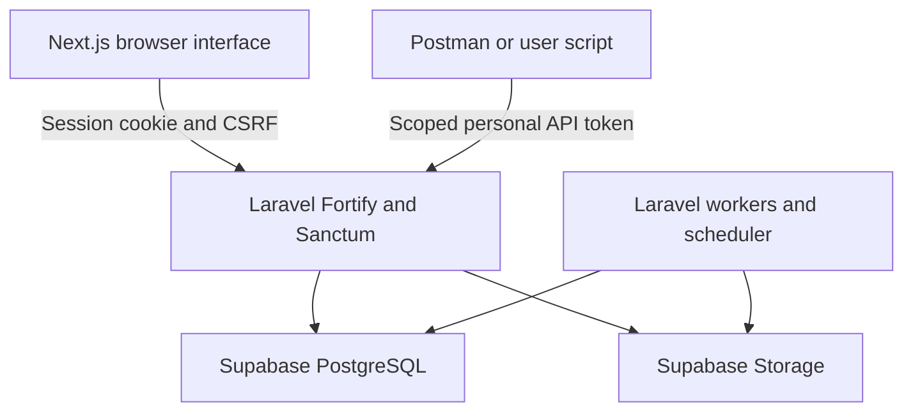

# System context

Laravel owns account credentials, sessions, CSRF and personal-token management. Supabase provides database/storage services. Public listing reads need no login. Private browser actions use session authentication; approved non-browser endpoints enforce token abilities and current Policies.

Use controlled sibling subdomains or a deliberately tested same-origin proxy. Next.js server rendering is optional; it must not cache private responses or assume cookies forward automatically. See [setup](authentication-setup.md).
