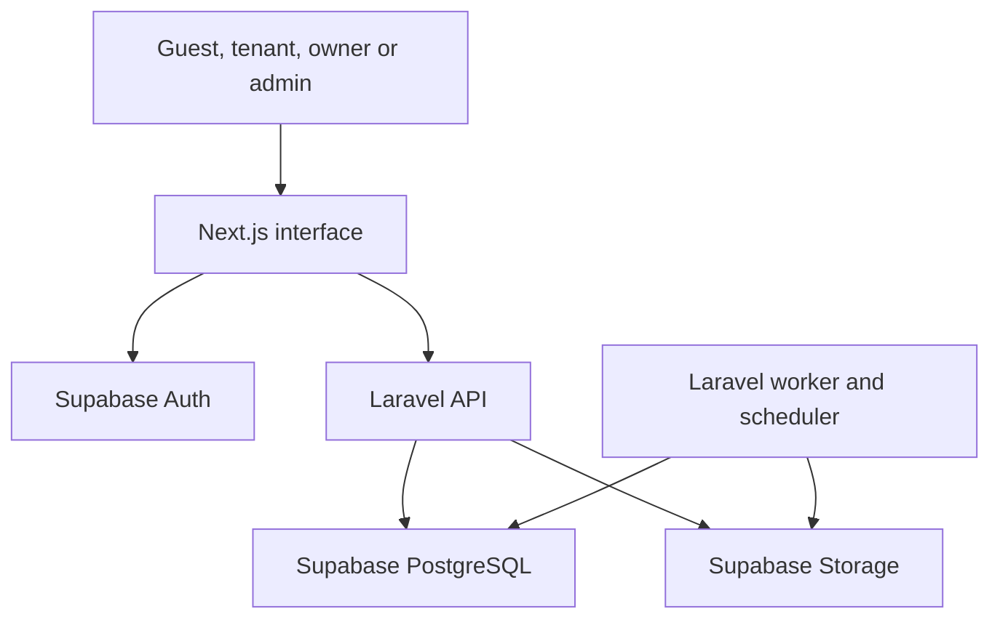

# System context

Supabase Auth owns identity/password/recovery. Laravel verifies that identity at issuance and owns expiring Sanctum product API tokens. Next.js calls Laravel for application data; browser Storage access uses only explicitly authorized upload/download capability paths. Application tables are not directly writable through a browser Data API key.

Workers deliver committed events and run bounded retry/expiry/15-day actions. Telescope supplies restricted diagnostics; alert delivery is separate. Hosting providers and installed versions must be discovered from the repository before implementation.
